# RemboAI Glance

**Your AI receptionist handles routine work. You handle the decisions on your Even Realities G2.**

**Hackathon:** Heads Up: Even Realities Hackathon 2026
**Track:** Messaging & News · **Special prize:** Best Telegram Integration · [Judging criteria](https://dorahacks.io/hackathon/even-realities/detail#judging)

RemboAI Glance is a glasses-first escalation client for salon and barbershop owners. It extends RemboAI's customer-reception workflow by bringing conversations that need human judgement to the owner's G2. The owner can inspect customer-visible context, prepare or dictate a reply, review the exact outgoing text, approve it, check its submission status, and resolve the case. The phone is a companion for pairing, recovery, and optional editing, and the normal operating surface is the glasses.

Glance does not mirror a messaging app on smart glasses. It gives a busy owner a safe, focused way to handle the exceptions their receptionist should not decide alone.

> **Status:** Verified in the Even Hub Simulator with synthetic data. Physical G2 microphone and ring acceptance, live ASR, and packaged-WebView networking are still pending. See [Verification and limitations](#verification-and-limitations).

**Prior work:** The [RemboAI backend](https://github.com/Greatman62k/remboai) existed before this hackathon.

## Contents

- [At a glance](#at-a-glance)
- [Demo](#demo)
- [Built during the hackathon](#built-during-the-hackathon)
- [The problem](#the-problem)
- [Example](#example)
- [Why it matters](#why-it-matters)
- [What makes Glance different](#what-makes-glance-different)
- [The owner workflow](#the-owner-workflow)
- [Designed for the G2 display and controls](#designed-for-the-g2-display-and-controls)
- [Voice input with an explicit human decision](#voice-input-with-an-explicit-human-decision)
- [Reply state and safety](#reply-state-and-safety)
- [Design decisions](#design-decisions)
- [Architecture](#architecture)
- [Technology](#technology)
- [Run the Glance client locally](#run-the-glance-client-locally)
- [Verification and limitations](#verification-and-limitations)
- [Security notes](#security-notes)
- [Roadmap](#roadmap)
- [FAQ](#faq)
- [Acknowledgements](#acknowledgements)
- [License](#license)

<p align="center">
  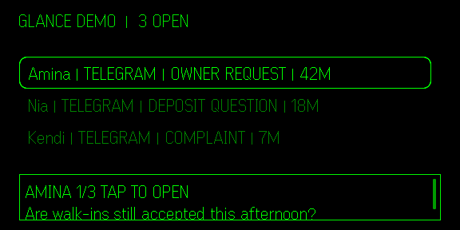
  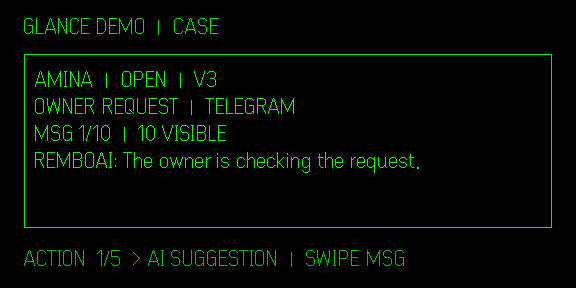
</p>
<p align="center"><sub>Native 576 × 288 captures from Even Hub Simulator using synthetic demo records. These are not photographs of physical glasses.</sub></p>

---

## At a glance

| | |
|---|---|
| **Built for** | Salon and barbershop owners who are serving customers while enquiries arrive |
| **Wearable** | Even Realities G2, through Even Hub |
| **Primary workflow** | Escalation inbox → case context → reply preparation → exact-text review → approval → outcome → resolution |
| **Customer channel in the demo** | Telegram |
| **Companion phone** | Pairing, recovery, device administration, and optional long-form editing |
| **Backend** | The existing RemboAI platform, extended with a dedicated Glance API |

## Demo

<!-- Add the 10 to 15 second simulator GIF here when the final capture is ready. The intended sequence is inbox, case, then exact-text approval review. -->

**Demo video:** The public video link has not been added yet.

The walkthrough follows one escalation from inbox to resolution: opening a case, reading its context, preparing a draft by voice, reviewing the exact text page by page, approving it, and checking the outcome.

The demo runs in the Even Hub Simulator with synthetic records. It is not footage of physical glasses or of a live ASR transaction. To step through the same screens yourself, see [Synthetic screen previews](#synthetic-screen-previews).

## Built during the hackathon

- **The Glance G2 client:** TypeScript and Vite app with native 576 × 288 layouts, paginated case context, and SDK event handling for touch and ring input.
- **The dedicated Glance API:** authenticated endpoints on the RemboAI backend for pairing, inbox, case context, drafts, transcription, reply approval, outcome, and resolution.
- **The voice flow:** bounded, owner-started G2 microphone capture, with a choice between using a transcript as a reply or as an instruction.
- **Exact-text approval:** page-by-page review followed by a separate confirmation action.
- **Reply outcome tracking:** distinct queued, submitted, delivered, failed, and unknown states, with owner acknowledgement for unknown outcomes.
- **Safe retries:** payload-bound idempotency records that survive a WebView interruption.

## The problem

A salon owner can be in the middle of a haircut, colour treatment, or consultation while customer messages continue to arrive. Some questions are routine: service information, opening hours, or supported booking requests. Others need the owner's judgement: an exception, a complaint, a special request, or a detail the receptionist should not invent.

Making the owner inspect every message creates constant interruptions. Letting automation answer every message creates a different risk: the system may make a business decision that belongs to a person.

## Example

A customer asks, "Are walk-ins still accepted this afternoon?" The question needs the owner's confirmation, so RemboAI raises an escalation. While finishing a colour treatment, the owner opens the case on G2, checks the conversation, prepares a short reply, reviews the exact wording page by page, and approves it. Glance then shows the reply's actual submission state. If the sending outcome is uncertain, it does not send the message again automatically.

This is an illustrative scenario using synthetic demo content, not a real customer conversation.

## Why it matters

Glance reduces avoidable interruptions while keeping the owner in charge of consequential customer decisions. It gives the owner a compact view of the conversation, a way to prepare a response while working, and a deliberate approval step before the response enters the sending queue.

The design has three operational goals: keep routine work moving, preserve human judgement for exceptions, and make the outcome of an approved reply visible so the owner never has to assume it.

## What makes Glance different

- **Built around exceptions:** Glance connects to the receptionist's owner-escalation workflow, so the owner sees the cases that need judgement and skips the routine stream.
- **Context first:** the owner can inspect the customer-visible case history before preparing a reply.
- **Voice assists drafting:** spoken input creates or revises a draft. Only a separate approval action can queue a reply.
- **Inspectable approval:** the owner reads the exact final text page by page and then confirms it.
- **Honest outcomes:** queued, submitted, delivered, failed, and unknown are separate states, and provider acceptance is never reported as customer delivery.

Responsibility is split as follows:

- RemboAI handles supported routine customer interactions through its receptionist workflows.
- When a conversation needs a person, the backend records an owner escalation.
- Glance puts the case and its relevant customer-visible context on the G2.
- The owner remains responsible for the final decision and any outgoing reply.

## The owner workflow

The normal operating loop stays on the glasses. The paired phone is not required to inspect a case, prepare a reply, review it, approve it, check its outcome, or resolve it.

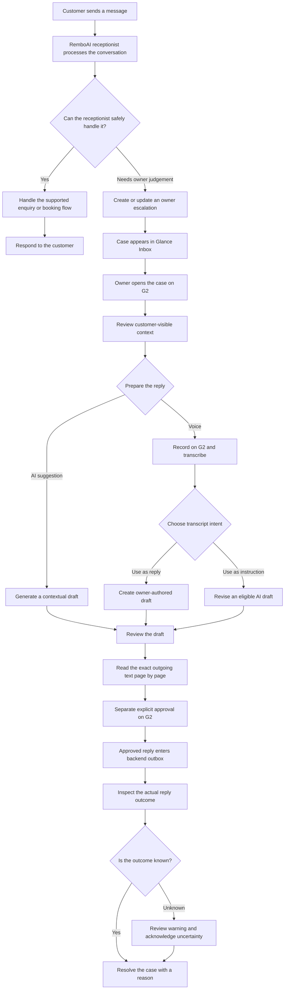

### What the owner can do

| Glance area | Purpose |
|---|---|
| **Inbox** | Browse owner work and open an escalation without opening the phone |
| **Case** | Inspect bounded pages of customer-visible conversation context and the current case state |
| **Voice** | Start a short, owner-initiated G2 microphone recording and choose how its transcript is used |
| **Outcome** | Inspect reply submission state, acknowledge an uncertain result when required, and resolve the case |
| **Schedule** | View the owner's salon-local daily schedule as a read-only supporting view |

A generated draft is a suggestion and a transcript is input. Neither sends anything until the owner reviews and approves the final text.

## Designed for the G2 display and controls

The G2 display is a compact **576 × 288** surface. Glance uses four reusable native layout families instead of shrinking a phone interface onto the glasses: home/inbox, case and reply workspace, voice interaction, and outcome/confirmation. Long messages are paginated to keep the text legible.

| Input | Glance behaviour |
|---|---|
| Swipe or scroll up/down | Browse inbox rows, conversation context, draft/transcript/reply pages, and sequential review pages |
| Single click | Open the selected inbox case. On other screens, move focus between available actions |
| Double-click | Activate the visibly selected action |
| Native contextual menu | Provide named shortcuts for the current screen |
| Long press/release | Reserved for Even Hub's contextual menu. Glance does not use it for critical actions |

On the inbox root, double-click invokes Even Hub's system exit confirmation. The same selection and activation model applies to supported G2 touch and ring event sources. Physical ring and temple behaviour still requires device validation. See [Verification and limitations](#verification-and-limitations).

### Exact-text approval

Before approval, Glance divides the outgoing reply into ordered pages of up to three wrapped text lines. The owner advances through the pages in order, and only after the review sequence is complete does the final-confirmation action become available.

Review progress resets if the text changes, the case version changes, the owner cancels, or the app resumes from a background interruption. If the G2 renderer may alter unsupported characters, Glance offers an explicit **Create ASCII copy** action. It creates a new version of the text, and the owner reviews it from the beginning before approving.

<p align="center">
  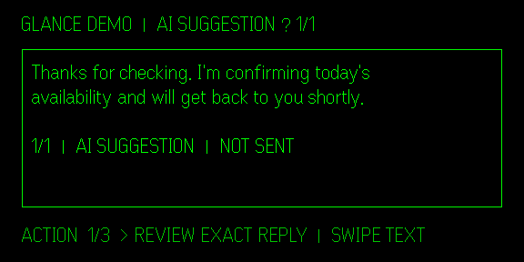
  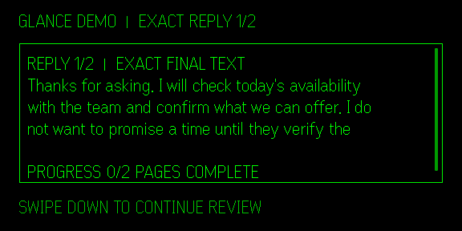
</p>
<p align="center"><sub>Draft preparation and exact-text review using synthetic simulator content.</sub></p>

## Voice input with an explicit human decision

Voice is an optional way to prepare or revise a reply while the owner's hands are occupied. It grants no permission to approve, send, or resolve anything.

1. The owner navigates to **Voice** and explicitly selects **Start**.
2. Glance opens the G2 microphone and accepts only glasses-source audio events. There is no phone-microphone fallback.
3. Audio is captured as mono, 16 kHz, signed 16-bit little-endian PCM, with a 40-second limit (1,280,000 bytes).
4. The bounded audio buffer is submitted to the authenticated Glance transcription endpoint.
5. The owner chooses **Use as reply**, **Use as instruction**, or cancel.
6. The resulting draft goes through the same exact-text approval process as any other draft.

**Use as reply** creates an owner-authored manual draft. **Use as instruction** is available only when an eligible current, unexpired, unedited AI draft exists, and it revises that draft.

The microphone closes on stop, cancellation, backgrounding, navigation, errors, session loss, or page exit, and recording never resumes automatically after suspension.

**Data handling:** audio is not persisted and is cleared after upload, failure, cancellation, or navigation. The transcript stays in active app memory until the owner chooses an intent. After that choice, a pending idempotency record may temporarily hold the selected draft or revision payload so an interrupted write can reuse the same action key, and it is cleared on success. Neither audio nor transcript is written to logs or analytics.

<p align="center">
  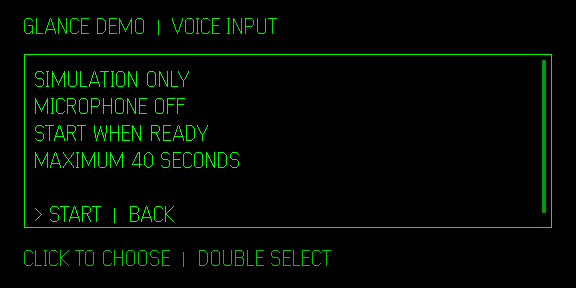
  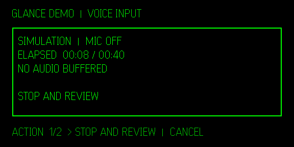
  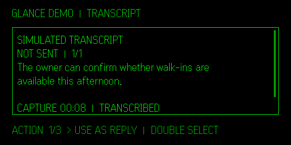
</p>
<p align="center"><sub>Voice UI states shown in the simulator. These captures do not represent a live microphone recording or a successful ASR-provider transaction.</sub></p>

## Reply state and safety

Glance keeps approval, provider submission, delivery, and case resolution visibly separate.

| State | Meaning |
|---|---|
| **Queued** | RemboAI has durably recorded the approved reply for sending |
| **Sending** | The backend is attempting provider submission |
| **Submitted** | The messaging provider accepted the send request. This does not prove that the customer received or read it |
| **Delivered** | A provider delivery receipt was received, where that channel supports one |
| **Failed** | The provider definitively rejected the submission or the backend recorded a known failure |
| **Unknown** | The outcome is ambiguous. The customer may already have received the message, so Glance does not blindly retry |

For the Telegram demonstration, provider acceptance is not presented as customer delivery confirmation. An unknown outcome requires an explicit owner acknowledgement before resolution. Resolving a case does not mark a payment as paid, issue a refund, or otherwise alter payment state.

<p align="center">
  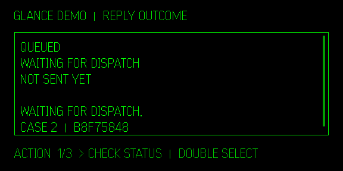
  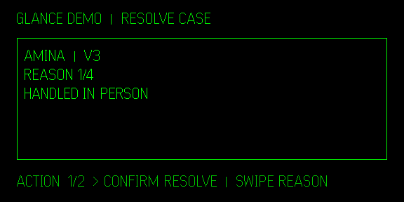
</p>
<p align="center"><sub>A queued reply and the normal resolution flow, using synthetic simulator content.</sub></p>

Further safeguards:

- **Owner-scoped authority:** the paired session determines salon and owner access. The client does not supply salon, customer, recipient, or channel IDs as authority.
- **Server-side revalidation:** the backend checks the current owner-to-salon relationship whenever it handles an authenticated request.
- **Version-aware actions:** stale case or draft state is rejected rather than applied to outdated context.
- **Idempotent writes:** a pending action keeps its key and exact payload across a WebView interruption, so a retry does not create a duplicate action.
- **Bounded voice capture:** only an owner-started G2 microphone session is accepted.

## Design decisions

- **Why review text page by page?** The G2 has a 576 × 288 display. Pagination keeps the final wording readable and gives the owner a deliberate review sequence before approval.
- **Why no automatic sending?** A customer-facing commitment belongs to the business owner. An AI suggestion is not permission to send it.
- **Why can voice not approve?** Transcription can be incomplete or incorrect. Voice can prepare a draft, but a separate explicit action is required to approve it.
- **Why create an ASCII copy?** Some characters may not render consistently on the G2. Glance creates a visibly display-safe copy and requires a fresh review because the text has changed.
- **Why avoid automatic retries after an unknown outcome?** A provider may have accepted a message even when the response was lost. Resending could create a duplicate, so the owner must inspect and acknowledge the uncertainty.

## Architecture

RemboAI Glance is a separate G2-facing client integrated with the existing RemboAI backend. The backend remains authoritative for salon ownership, case state, drafts, approval, outbox dispatch, reply status, and resolution.

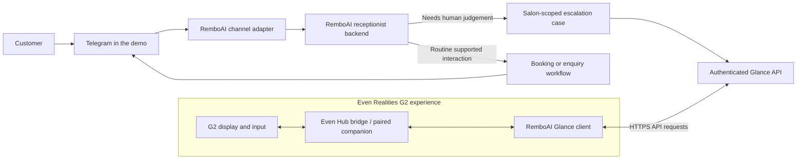

### Main client responsibilities

| Module | Responsibility |
|---|---|
| `src/main.ts` | Wait for the Even Hub bridge, create/rebuild native pages, and route SDK events |
| `src/glasses-ui.ts` | Construct bounded native layouts for the 576 × 288 display |
| `src/app.ts` | Coordinate inbox, schedule, case, voice, draft, review, reply status, and resolution workflows |
| `src/client.ts` | Typed authenticated Glance API client, request timeouts, request IDs, retry-after handling, and no-store requests |
| `src/session.ts` | Pairing exchange and revocable session handling |
| `src/workflow.ts` | Workflow helpers and payload-bound pending idempotency records |
| `src/evenhub-events.ts` | Parse SDK input, audio-source, and display-lifecycle events |
| `src/audio-capture.ts` | Bounded, owner-initiated G2 microphone capture |
| `src/voice-intents.ts` | Keep owner-authored replies separate from instructions that revise an eligible AI draft |
| `src/demo-fixtures.ts` | Synthetic records for offline simulator previews only |

### Glance API surface used by the client

The client is configured against the `/api/v1/glance` API root and uses the following operations:

| Operation | Purpose |
|---|---|
| `POST /pairing/exchange` | Exchange a one-time owner pairing code for a device session |
| `DELETE /sessions/current` | Revoke the current paired session |
| `GET /attention` and `GET /inbox` | Retrieve bounded owner attention and open-case views |
| `GET /schedule` | Retrieve the authenticated owner's salon-local daily schedule |
| `GET /cases/{case_id}` and `GET /cases/{case_id}/status` | Retrieve case context and current case status |
| `POST /cases/{case_id}/drafts` | Generate a contextual AI draft |
| `POST /cases/{case_id}/drafts/manual` | Create an owner-authored draft |
| `POST /cases/{case_id}/drafts/{draft_id}/revise` | Revise an eligible AI draft using an owner instruction |
| `POST /transcriptions` | Transcribe bounded raw G2 PCM audio |
| `POST /cases/{case_id}/replies` and `GET /replies/{reply_id}` | Approve/queue the exact reply and inspect its outcome |
| `POST /cases/{case_id}/resolve` | Resolve the case through the backend's guarded workflow |

The paired session is the authority boundary. The client uses bearer authentication, omits cookies, and requests `no-store` responses. The browser-stored bearer token is revocable but is not a native Keychain or Keystore secret. See [Security notes](#security-notes).

## Technology

**Glance client**

- TypeScript and Vite
- Even Hub SDK `@evenrealities/even_hub_sdk` 0.0.16
- Even Hub CLI and Simulator 0.9.5 for development and local display testing
- Native G2 page/container rendering and SDK event handling

**RemboAI backend**

- Python 3.13 and FastAPI
- PostgreSQL for business, case, draft, and outbox state
- Redis for short-lived coordination and rate limiting
- Configurable language-model and ASR integrations
- Telegram Bot API for the submission demonstration. Other channel code in the broader backend has not been accepted end-to-end through Glance

## Run the Glance client locally

### Requirements

- Node.js and npm
- The dependencies pinned in `package-lock.json`
- Even Hub Simulator 0.9.5 for local G2 display testing

### Install

```bash
npm ci
```

### Configure

Copy the example environment file:

```bash
cp .env.example .env.local
```

Set the API root in `.env.local`:

```dotenv
VITE_GLANCE_API_BASE=https://<your-remboai-host>/api/v1/glance
VITE_GLANCE_DEMO_FIXTURES=false
```

The configured URL is the intended API root. A successful production or staging connection from the packaged Even Hub WebView has **not** yet been verified. Do not put bearer tokens, provider credentials, database URLs, or other secrets in Vite variables, because they are compiled into the client bundle.

### Start development and run checks

```bash
npm run dev
npm test
npm run build
```

### Open the simulator

```bash
evenhub-simulator http://127.0.0.1:5173 --automation-port 9898 --no-glow
```

The simulator exposes a 576 × 288 display. Its `/api/ping` endpoint only indicates that the simulator process is ready. It does not prove that the WebView, Even Hub bridge, startup page, or framebuffer is ready. Wait for the app to report `G2 connected · 576 × 288`, or confirm that the glasses display contains a rendered frame, before capturing.

### Synthetic screen previews

Development builds support `?g2-preview=` states for offline UI walkthroughs:

`inbox`, `schedule`, `case`, `case-older`, `draft`, `voice-ready`, `voice-recording`, `transcript-preview`, `approval-review`, `approval-confirm`, `reply-status`, `resolve`, and `case-resolved`.

For example:

```bash
evenhub-simulator 'http://127.0.0.1:5173/?g2-preview=voice-recording' --automation-port 9898 --no-glow
```

These routes use synthetic fixtures, skip saved-session loading and backend polling, and never start the microphone. Recording states are marked as simulation with the microphone off. They are for UI review only. They send no customer messages and say nothing about backend or provider behaviour.

## Verification and limitations

The repository includes automated tests for the client workflow, SDK event handling, native page payloads, request behaviour, voice-intent separation, and bounded PCM capture. The simulator provides local visual and interaction checks. These checks do not replace physical-device and live-service acceptance.

| Area | Current evidence / status |
|---|---|
| G2 screen layout | Native 576 × 288 layouts exercised in Even Hub Simulator 0.9.5 |
| Client workflow | Automated tests and synthetic simulator walkthroughs |
| Voice state machine | Owner-started capture path and injected PCM tests. Simulator audio itself is not treated as captured speech |
| Physical G2 microphone and ASR | Not yet accepted on physical G2 with the live ASR provider |
| Ring and temple controls | SDK event handling is implemented. Physical-device behaviour remains to be validated |
| Locked-phone / background lifecycle | Resume and recovery logic is implemented. Complete phone-locked hardware acceptance remains outstanding |
| Packaged WebView networking | Production HTTPS routing and packaged WebView CORS acceptance remain outstanding |
| Live Telegram delivery | Channel-specific end-to-end acceptance is separate from simulator previews |

The local simulator environment can expose a zero-sample audio input, so automated voice-capture tests inject controlled PCM events. They do not establish that the physical G2 microphone captured speech. Android may suspend the WebView while it is backgrounded. Glance closes microphone capture on suspension and does not claim that recording continues or resumes automatically.

## Security notes

- Pairing codes are exchanged for revocable owner sessions, and the backend revalidates owner and salon authority on requests.
- The frontend bearer token is stored in browser `localStorage` until expiry or revocation. This is not equivalent to native Keychain or Keystore storage.
- Authenticated API requests use bearer authorization, omit cookies, and set `cache: no-store`.
- The backend is authoritative. Browser state is never treated as the source of truth for case context, approval, or reply status.
- Audio and transcript handling is described under [Voice input](#voice-input-with-an-explicit-human-decision).
- Synthetic fixtures are isolated from live API calls and sending behaviour.
- Never commit `.env.local` or expose backend secrets, pairing keys, provider credentials, or database connection strings in the client bundle.

## Roadmap

The next validation steps are:

- Complete the end-to-end workflow on physical G2 hardware, including supported ring and temple inputs.
- Verify G2 microphone capture and live transcription with the packaged app.
- Complete HTTPS staging and packaged Even Hub WebView CORS acceptance.
- Validate the glasses-first workflow with the phone locked and document any lifecycle restrictions.

These are validation tasks, and none of them is a claim of completed hardware acceptance.

## FAQ

**Can Glance send a reply without the owner's approval?**
No. AI generation and voice transcription only prepare drafts. The owner must review the exact final text and approve it separately.

**Does "Submitted" mean the customer received the message?**
No. It means the messaging provider accepted the request. It is not proof of delivery or reading.

**What happens when the send outcome is unknown?**
Glance does not automatically resend. The owner can check the status and must explicitly acknowledge the uncertainty before resolving the case.

**What happens if the glasses disconnect or the WebView is suspended during an action?**
Glance refreshes server state when it resumes. An unresolved write retains its original idempotency key and payload, so recovery does not create a new action. An interrupted microphone recording is discarded and must be started again.

**What happens when the session expires?**
Authenticated requests stop. The owner must pair the device again through the supported owner channel.

**Does the phone have to remain unlocked?**
The workflow is designed to keep normal case handling on G2, but the complete locked-phone experience has not yet been accepted on physical hardware. Android may suspend the companion WebView when backgrounded.

## Acknowledgements

Thanks to Even Realities for the Even Hub SDK and simulator used to build and test the G2 experience.

## License

Released under the MIT License. Copyright (c) 2026 RemboAI. See the full [MIT License](LICENSE).

---

**RemboAI Glance: Customer escalations, one glance away.**
