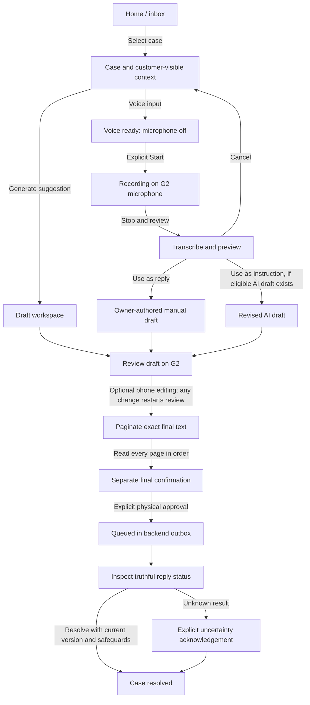

# RemboAI Glance: glasses-first workflow

The G2 is the normal operating surface for an owner handling an escalation. The phone companion is for pairing, account recovery, device administration, advanced setup, and optional long-form editing. It is not needed to inspect context, create a reply, review the final text, approve it, check its outcome, or resolve a case.

The existing G2 design pack under `docs/design/g2/remboai-glance-g2-design-pack/` is preserved as an earlier design artifact. Its phone-required approval flow does not describe the current product direction.

## Normal operating loop

The backend remains authoritative. Drafts, approval, idempotency, outbox dispatch, reply status, version checks, and resolution use the existing authenticated Glance API. Transcription only supplies words for an owner-selected draft action. Neither an AI draft nor a transcript authorizes sending.

## G2 and ring interaction model

| Input | Normal use |
|---|---|
| Swipe/scroll up or down | Browse inbox rows, older/newer context, draft/transcript/reply pages, reason choices, and sequential approval pages |
| Single click | Open the selected inbox case; on other screens move the action focus |
| Double-click | Activate the visibly selected action |
| Native contextual menu | Choose a named shortcut shown for the current state |
| Long press/release | Owned by Even Hub's contextual-menu interaction; never used as an application-critical action |
| Root-page double-click | Call `shutDownPageContainer(1)` and leave exit confirmation to Even Hub |

The same selection and activation rules apply to supported G2 touch and ring events. The event handler accepts the SDK's source-tagged envelopes, preserves a native list selection when a zero-valued click field is omitted, ignores non-input envelopes, and suppresses only duplicate cross-envelope press echoes. An audio event cannot become a click.

Voice begins at a microphone-off ready state. Only the explicit Start action opens `AudioInputSource.Glasses`. Stop, cancel, backgrounding, navigation, session loss, capture errors, or page exit close capture. Capture is never resumed automatically.

## Reusable native display layouts

The implementation uses four reusable layout families rather than imposing an application-wide screen count:

1. **Home/inbox:** open count, selected customer/channel/category/wait age, short preview, stale/offline/new-case state.
2. **Case and reply workspace:** bounded customer-visible context pages, draft pages, exact outgoing text pages, and current case/version labels.
3. **Voice interaction:** ready, recording, stopping, transcription, transcript preview, and explicit intent actions.
4. **Outcome and confirmation:** final approval, queued/submitted/failed/unknown status, uncertainty acknowledgement, and resolution.

The native UI uses at most three text containers or two text containers plus one list container per page, exactly one event-capturing container, and stable container identifiers. Content-only changes use SDK text updates. Layout or menu changes rebuild the current page. Text is concise, left-aligned by the native renderer, and sized within a 576 × 288 canvas; long content is paginated instead of reduced to a tiny font. Case context uses one visible event per page so wrapped text and the older-history marker fit without clipping.

## Exact-text approval

The full outgoing message is split into ordered pages of at most five wrapped text lines so the exact text, page position, and review progress fit together on the 576 × 288 display. Each page displays its position and is marked reviewed only after the owner advances through it. A separate final-confirmation state appears only after every page has been traversed. The owner must then explicitly choose **Approve & queue**. Cancelling, changing the draft, editing the text, detecting a changed case, or returning from background resets review progress.

The SDK's display font handling is not a guarantee that every Unicode character will render byte-for-byte. When a draft includes unsupported glyphs, G2 offers an explicit **Create ASCII copy** action. It saves a new owner draft through the existing manual-draft endpoint, converts known punctuation and diacritics, and shows unknown glyphs as `?`. This is a content change: the owner must inspect the new exact text on G2 and complete a fresh review before approval. The optional phone editor remains available, but is not required for this path.

## Lifecycle and recoverable state

Android may suspend and recreate the WebView when the Even Realities app is backgrounded. Glance therefore persists only:

- The revocable bearer session and its expiry, using the existing browser storage model.
- The active case ID and the persisted draft snapshot needed to reopen the workspace.
- An unresolved write's idempotency key and payload, so a cold restart cannot create a second write with a new key.

The active customer timeline is fetched again from the backend; it is not treated as authoritative browser storage. Audio is never persisted. A transcript is kept in active memory until the owner chooses a draft intent. The selected write payload may then be held with its pending idempotency key until the server result is known; success clears it. No transcript, message body, audio, token, or customer identity is written to logs or analytics.

On resume, the app validates the saved session, refreshes inbox or case status, and recovers the active case without approving or dispatching anything. An interrupted microphone session is discarded and must be explicitly restarted. Pending reply status is refreshed with bounded polling; a lost approval response is recovered using the same idempotency key and backend case/reply state.

## Performance instrumentation

`GlanceAppController.getRuntimeMetrics()` exposes in-memory aggregate counters for development diagnostics. The counters include API request total/max latency, polling count, native page rebuilds, text updates, duplicate updates skipped, bridge updates coalesced, maximum queued bridge writes, display update total/max latency, and peak PCM buffer bytes. They contain no response bodies, transcripts, audio, tokens, or customer identifiers.

These counters measure the WebView/bridge path that runs them. They are not G2 hardware latency measurements. The simulator uses different display rendering and audio behavior from physical glasses, and mocked API tests do not measure network or provider performance.

One local Simulator 0.9.5 fixture run (startup, inbox selection, case context page, then draft) recorded 1 startup page creation, 2 page rebuilds, 2 text-container updates, 2 duplicate updates skipped, 0 coalesced updates, and a maximum of 1 queued bridge write. The measured display bridge total was 555 ms, with a 327 ms maximum operation; API requests and polls were both 0 because this was a synthetic fixture. The capture service allocates at most 1,280,000 PCM bytes; the automated boundary test reached that cap. The simulator preview itself captured no audio, so its peak was 0 bytes. These are local sample values, not device benchmarks.

## Native simulator captures

The images below are synthetic fixtures rendered by the Even Hub Simulator 0.9.5 into its native `Glasses Display` window. Each PNG is cropped to the active 576 × 288 framebuffer; they are not phone WebView screenshots or hardware captures. The simulator's RGBA screenshot endpoint was transparent in this Linux session, so captures came from the simulator's native display widget.

- Inbox: [inbox.png](glasses-first-captures/inbox.png)
- Latest context and older context: [case-page-1.png](glasses-first-captures/case-page-1.png), [case-older-page.png](glasses-first-captures/case-older-page.png)
- AI suggestion and dictated owner draft: [draft.png](glasses-first-captures/draft.png), [owner-draft.png](glasses-first-captures/owner-draft.png)
- Voice ready, simulated recording, and transcript: [voice-ready.png](glasses-first-captures/voice-ready.png), [voice-recording.png](glasses-first-captures/voice-recording.png), [transcript-preview.png](glasses-first-captures/transcript-preview.png)
- Exact-text review and separate confirmation: [approval-review.png](glasses-first-captures/approval-review.png), [approval-confirm.png](glasses-first-captures/approval-confirm.png)
- Daily schedule: [schedule.png](glasses-first-captures/schedule.png)
- Reply status, unknown outcome, and resolution: [reply-status.png](glasses-first-captures/reply-status.png), [reply-unknown.png](glasses-first-captures/reply-unknown.png), [resolve.png](glasses-first-captures/resolve.png), [resolve-unknown-warning.png](glasses-first-captures/resolve-unknown-warning.png), [case-resolved.png](glasses-first-captures/case-resolved.png)

## Acceptance status and required hardware checks

Automated tests exercise the state machine and native page payloads; the Even Hub simulator can capture a 576 × 288 framebuffer and simulate inputs. Neither proves operation while a phone is locked. Local/QR testing is not a substitute for official Beta Testing.

Before claiming the phone-free product loop is accepted, test on physical G2 using a private `.ehpk` and the official Beta Testing workflow. Keep the phone locked for the required five-minute QA interval, verify responsiveness after two minutes idle, and complete inbox browsing, context review, voice capture/transcription, exact-text review, approval, status inspection, and resolution without bringing the phone forward. Also verify supported ring/temple inputs on hardware. A suspended Android WebView stops JavaScript microphone handling; Glance deliberately does not pretend that capture continues or silently resumes.
